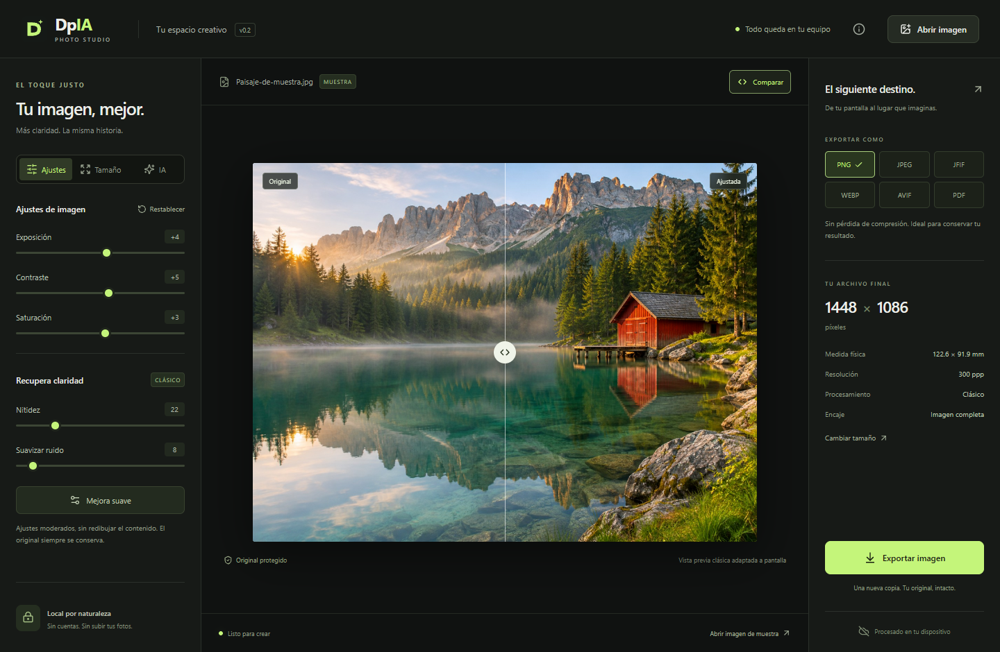
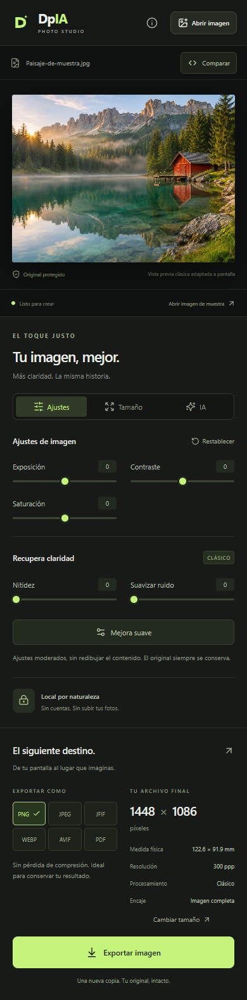
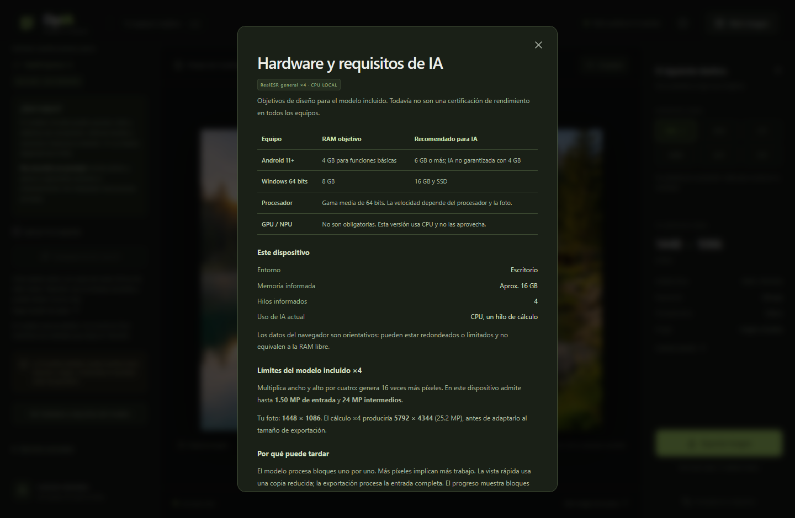

<p align="center"></p>
<h1 align="center">DpIA</h1>
<p align="center"><strong>Tu imagen, mejor. Más claridad. La misma historia.</strong></p>
<p align="center">Estudio de fotografía local · Windows y Android · Modo oscuro · IA opcional</p>
<p align="center"><a href="LICENSE">MIT</a> · <a href="docs/USO.md">Guía de uso</a> · <a href="docs/COMPILACION.md">Crear EXE y APK</a> · <a href="docs/IA.md">IA local</a> · <a href="docs/VALIDACION.md">Validación y límites</a></p>



**DpIA** permite ajustar fotografías, preparar tamaños de impresión y exportar copias sin sobrescribir el original. Se ejecuta en el dispositivo: no hay cuentas, analítica, servicios de pago ni subida de fotos. La muestra incluida es una imagen generada con IA para este proyecto; las fotos personales utilizadas durante la conversación no forman parte del repositorio.

## Qué incluye la versión 0.2.0

- Interfaz oscura adaptable, en español, con comparación antes/después.
- Exposición, contraste, saturación, enfoque suave y suavizado de ruido. Son filtros clásicos, no reconstrucción generativa.
- Tamaños ISO A0–A6, Carta, Legal, Tabloide, fotografía, HD, Full HD, 4K UHD y medidas personalizadas.
- Unidades mm, cm, pulgadas y píxeles; orientación, resolución en ppp, márgenes, fondo y encaje proporcional o recorte central.
- Exportación **PNG, JPEG/JPG, JFIF, WebP, AVIF y PDF**. La salida se comprueba por su formato real, no solo por la extensión.
- PNG/JPEG/JFIF con densidad de impresión; PDF con dimensiones físicas exactas. Para imprimir se recomienda PDF al 100 %.
- **IA opcional con modelo incluido:** RealESR general ×4 se carga automáticamente desde recursos locales. No necesita prompt. Ejecuta restauración/superresolución en CPU, con comparación sin/con IA, progreso por bloques, estimación variable y cancelación. Los modelos personalizados siguen siendo una opción avanzada.
- Aplicación Windows con Tauri y aplicación Android con Capacitor; un motor compartido en TypeScript/Web Workers.

SVG, TIFF, RAW, HEIC, procesamiento por lotes, restauración facial especializada, aceleración GPU y conversión profesional CMYK/PDF-X quedan fuera de esta versión. Los tamaños grandes pueden requerir bajar los ppp para respetar los límites de memoria.

## Empezar a desarrollar

Requiere Node.js 22 o posterior y npm. En la carpeta del proyecto:

```sh
npm ci
npm run dev
```

Abre `http://127.0.0.1:1420`. La primera instalación de dependencias requiere internet; las fotos se procesan localmente. La versión web es una herramienta de desarrollo y no incluye un service worker/PWA para instalación sin conexión.

```sh
npm test
npm run build
npm run test:e2e
```

Las pruebas visuales usan Microsoft Edge por defecto en Windows. En Linux u otros equipos: instala Chromium con `npx playwright install chromium` y configura `PW_CHANNEL=chromium`. Consulta [las instrucciones de pruebas](docs/VALIDACION.md).

## Crear el instalador de Windows (.exe)

La entrega inicial incluye un **EXE que abre directamente**, no un instalador. Para generar ese ejecutable:

```sh
npm ci
npm run desktop:exe
```

Resultado: `src-tauri/target/release/dpia.exe`. Usa Microsoft Edge WebView2 instalado en Windows. Se comprobó que la aplicación abre y muestra la imagen de muestra. El empaquetado NSIS falló en el entorno de construcción con error de carga de DLL 623; por eso no se anuncia un instalador que no se haya generado. Los comandos siguientes permiten construirlo en un entorno Windows compatible o mediante GitHub Actions.

Instala [Rust](https://www.rust-lang.org/tools/install), [Visual Studio Build Tools con desarrollo de escritorio en C++](https://v2.tauri.app/start/prerequisites/) y Node.js 22+. Luego:

```sh
npm ci
npm run desktop:build
```

Resultado: `src-tauri/target/release/bundle/nsis/DpIA_0.2.0_x64-setup.exe` para un entorno Windows x64. El nombre puede variar por arquitectura. El instalador no está firmado con un certificado comercial; necesita Microsoft Edge WebView2. El empaquetador puede descargar WebView2 si el equipo no lo tiene.

## Crear la aplicación Android (.apk)

En Android se instala un **APK**, no un EXE. Instala JDK 21 y Android Studio con SDK Platform 36 y Build Tools compatibles, y configura `JAVA_HOME` y `ANDROID_HOME`. El proyecto Android ya está incluido.

```sh
npm ci
npm run android:debug
```

Resultado: `android/app/build/outputs/apk/debug/app-debug.apk`, firmado con una clave local de desarrollo. El script crea esa clave en `.local/`, excluida de Git. Es una compilación de prueba instalable, no una publicación en Google Play. No compartas claves privadas.

```sh
npm run android:release
```

Genera un APK release **sin firma** en `android/app/build/outputs/apk/release/`. Para distribuir actualizaciones con tu identidad, abre `npm run android:open` y usa **Generate Signed App Bundle / APK** con tu propia clave. Los pasos completos están en [COMPILACION.md](docs/COMPILACION.md).

## Hardware y límites

| Plataforma | Objetivo básico | Recomendado |
|---|---|---|
| Android | Android 11+, procesador de 64 bits, 4 GB de RAM | 6 GB de RAM |
| Windows | Windows 10/11 de 64 bits con WebView2, 8 GB de RAM | 16 GB de RAM y SSD |

Son objetivos de diseño, **no certificaciones de rendimiento**. La IA no está garantizada en un móvil de 4 GB. Este prototipo usa CPU/WASM para IA; una GPU dedicada no es requisito ni se aprovecha todavía.

Límites de protección: archivos de hasta 40 MB; entrada máxima de 20 MP en móvil y 40 MP en escritorio; salida máxima de 12 MP en móvil y 24 MP en escritorio; dimensión máxima de salida de 16 384 píxeles. El modelo incluido ocupa unos 5 MB y conserva su licencia BSD-3-Clause. La IA limita su resultado intermedio a 12 MP en móvil y 24 MP en escritorio y puede necesitar entradas mucho menores. Un modelo ×4 multiplica por 16 la cantidad de píxeles. La RAM real consumida es mayor que el tamaño del archivo comprimido.

## En el celular



En Android, exportar abre el menú del sistema para guardar o compartir la copia. La copia temporal se conserva en la caché para permitir que la aplicación receptora la lea; las copias de más de 24 horas se limpian al exportar de nuevo. No se escribe sobre el archivo de entrada.

## Qué hace la IA y cómo evaluarla

El modelo puede suavizar ruido y defectos de compresión, reforzar contornos y reconstruir texturas al ampliar ×4. La mejora depende de la foto: puede cambiar detalles y no recupera con certeza lo perdido. No usa prompt porque procesa imágenes, no instrucciones de texto.

La vista rápida limita la entrada a 192 px en móvil y 320 en escritorio. La comparación sin/con IA usa la misma copia y los mismos ajustes clásicos. El informe muestra dimensiones y tiempo, sin una puntuación automática de calidad. Exportar procesa la entrada completa y puede tardar mucho más. En IA, el botón de requisitos abre una ventana dedicada con hardware y límites. Consulta [la guía de IA](docs/IA.md).



## Tecnología

React + TypeScript + Vite para la interfaz; Canvas/OffscreenCanvas y Web Workers para procesamiento; Tauri/Rust para Windows; Capacitor para Android; ONNX Runtime Web para IA; jSquash/libavif para AVIF; jsPDF para PDF. La ruta inicial basada en Python se sustituyó por un motor compartido para evitar distribuir Python en móviles.

## Documentación

- [Uso y formatos](docs/USO.md)
- [Compilación, EXE, APK y firmas](docs/COMPILACION.md)
- [Contrato de modelos e IA](docs/IA.md)
- [Arquitectura](docs/ARQUITECTURA.md)
- [Privacidad](docs/PRIVACIDAD.md)
- [Validación y limitaciones](docs/VALIDACION.md)
- [Hoja de ruta](docs/ROADMAP.md)
- [Contribuir](CONTRIBUTING.md) · [Historial](CHANGELOG.md) · [Componentes de terceros](THIRD_PARTY_NOTICES.md)

## Licencia

El código original y la documentación de DpIA se distribuyen bajo [MIT](LICENSE). Las dependencias y los modelos conservan sus licencias respectivas: MIT no las reemplaza. La imagen de muestra fue generada con la herramienta integrada de imágenes; no constituye una fotografía documental de un lugar real. Revisa [las atribuciones](THIRD_PARTY_NOTICES.md) antes de redistribuir.
