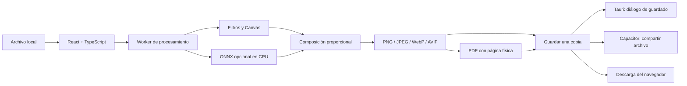

# Arquitectura

## Decisiones

Se comparte motor TypeScript para evitar un sidecar Python en Android. Tauri aporta una aplicación Windows basada en WebView2; Capacitor integra selector de archivos y exportación/compartición en Android. El modo oscuro utiliza fuentes del sistema, sin CDN.

`domain.ts` calcula conversiones, composición y presupuestos. `pixels.ts` aplica exposición, contraste, saturación, box blur separable para suavizado y máscara de enfoque. El suavizado es una aproximación clásica: no es un algoritmo neuronal de eliminación de ruido.

`processor.worker.ts` trabaja fuera del hilo de interfaz y compone el destino. `engine.ts` gestiona cancelación terminando el Worker. La vista previa tiene su propio Worker, se retrasa 180 ms al mover controles y se limita a 1100 píxeles en su lado mayor; la entrada clásica de vista previa se limita a 1400. Exportar usa el archivo original, no la vista previa.

`metadata.ts` inserta pHYs en PNG con CRC válido y densidad JFIF en JPEG. `save.ts` crea PDF mediante jsPDF y elige guardado nativo, compartir Android o descarga web. El runtime ONNX y el códec AVIF se empaquetan localmente; ningún recurso de ejecución depende de un CDN.

## Seguridad y memoria

Tauri solicita acceso solo al destino elegido en el diálogo de guardado; no expone ejecución de comandos. CSP restringe recursos a la aplicación y permite WASM/Workers. En Android no se requiere permiso general de lectura del almacenamiento: el usuario selecciona un archivo; la exportación usa FileProvider.

Se limita el tamaño del archivo antes de decodificar y la resolución tras decodificar. La comprobación de resolución ocurre después de abrir la imagen: archivos comprimidos hostiles pueden consumir memoria antes del rechazo. No se considera un entorno de análisis de archivos no confiables. Cancelar libera el Worker y sus buffers; el modelo importado permanece en memoria mientras la app siga abierta. No se almacenan proyectos ni historial persistente en esta versión.

## Cambios en 0.2.0

El modelo incluido está en public/models, con huella verificada por el prebuild y licencia conservada. Se carga desde la app al iniciar; inferencia solo si el usuario activa IA. El Worker emite progreso separado de los resultados para no resolver la operación antes de terminar. Se reutiliza sesión por identificador de modelo en exportaciones sucesivas. La vista rápida usa 192 px en móvil y 320 en escritorio, mientras que exportar conserva la entrada completa. El Worker devuelve una referencia sin IA con los mismos ajustes y encuadre para una comparación válida.

La entrada excesiva del modelo ×4 se comprueba antes de exportar. La copia ligera es una acción explícita que reduce la entrada sin escribir sobre el original. JFIF usa image/jpeg y la misma ruta de densidad JFIF, con extensión .jfif. El código público y las binarios incluyen el modelo; stage-source permite solo ese modelo validado, además del fixture de pruebas.
